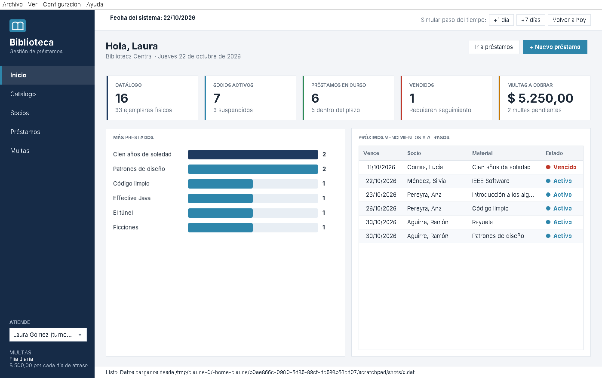
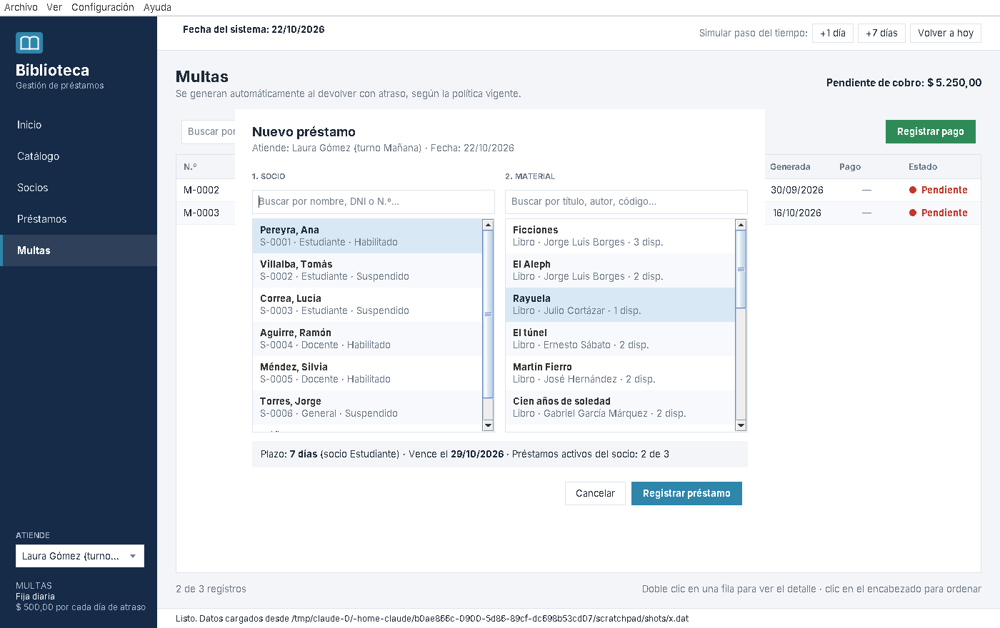

# Sistema de Gestión de Biblioteca

Proyecto Final Integrador — **Lenguajes 2** · Ingeniería en Informática

Aplicación de escritorio en **Java + Swing** para administrar una biblioteca: catálogo de libros y revistas con sus ejemplares físicos, socios de distintas categorías, préstamos, devoluciones, renovaciones y multas por atraso.



## Integrantes

| Apellido y nombre | Legajo |
|---|---|
| _completar_ | _completar_ |

## Cómo ejecutarlo

Requisito: **JDK 17 o superior** (no usa librerías externas).

| Opción | Comando |
|---|---|
| JAR ya compilado | `java -jar BibliotecaPFI.jar` |
| Windows | doble clic en `compilar_y_ejecutar.bat` |
| Linux / macOS | `./compilar_y_ejecutar.sh` |
| IDE | Abrir la carpeta como proyecto Java (IntelliJ, NetBeans o Eclipse), marcar `src` como carpeta de fuentes y ejecutar `biblioteca.Main` |

La primera vez arranca con **datos de ejemplo** (16 títulos, 7 socios, préstamos vigentes, uno vencido y multas). Todo cambio se guarda automáticamente en `biblioteca.dat`, en la carpeta desde donde se ejecuta. Para volver al estado inicial: **Archivo → Restaurar datos de ejemplo**.

Pruebas de reglas de negocio (19 casos): `./ejecutar_pruebas.sh`

## Funcionalidades

- **Catálogo**: alta de libros y revistas, búsqueda sin importar tildes ni mayúsculas, filtros, gestión de ejemplares (agregar, enviar a reparación).
- **Socios**: alta y edición de estudiantes, docentes y público general; baja/reactivación; historial de préstamos.
- **Préstamos**: el plazo depende de la categoría del socio y del tipo de material; renovación única; aviso previo de la multa al devolver.
- **Multas**: se generan solas al devolver con atraso, con descuento según la categoría; registro de pago.
- **Panel de inicio**: indicadores, ranking de materiales más prestados (gráfico dibujado con Java2D) y vencimientos.
- **Simulación de fecha**: botones `+1 día`, `+7 días` y `Volver a hoy` para mostrar vencimientos y multas en vivo durante la defensa.
- **Política de multas intercambiable** (Configuración): fija diaria o progresiva.

### Reglas de negocio

| Categoría | Préstamos simultáneos | Plazo | Descuento en multas |
|---|---|---|---|
| Estudiante | 3 | 7 días | 50 % |
| Docente | 5 | 14 días | 25 % |
| Público general | 2 | 10 días | — |

- Las revistas se prestan como máximo 3 días; los libros hasta 30 (siempre limitado por la categoría).
- Un socio con multas impagas o préstamos vencidos queda **suspendido** y no puede retirar material.
- Cada préstamo se puede renovar una vez, solo si no está vencido.
- No se puede eliminar un material con ejemplares prestados ni dar de baja a un socio con préstamos pendientes.

## Diseño orientado a objetos

Diagramas en [`uml/Diagrama_de_Clases_UML.pdf`](uml/Diagrama_de_Clases_UML.pdf) (página 1: dominio; página 2: interfaz gráfica). También en PNG de alta resolución en la misma carpeta.

| Concepto | Dónde se aplica |
|---|---|
| **Herencia** | `Persona` → `Socio` / `Bibliotecario`; `Socio` → `SocioEstudiante` / `SocioDocente` / `SocioGeneral`; `MaterialBibliografico` → `Libro` / `Revista` |
| **Clases abstractas** | `Persona`, `Socio`, `MaterialBibliografico`, `PanelListado<T>`, `DialogoBase` |
| **Polimorfismo** | Cada categoría de socio redefine `getMaxPrestamos()`, `getDiasPrestamo()` y `getDescuentoMulta()`; cada material redefine `getPlazoMaximoDias()` |
| **Interfaces** | `Identificable`, `Buscable`, `Prestable`, `PoliticaMulta`, `Repositorio<T>`, `BibliotecaListener`, `Actualizable` |
| **Composición** | `MaterialBibliografico` ◆— `Ejemplar` · `Prestamo` ◆— `Multa` · `Biblioteca` ◆— repositorios |
| **Agregación** | `Libro` ◇— `Autor` (un autor se comparte entre libros) · `Biblioteca` ◇— observadores |
| **Asociación** | `Socio` — `Prestamo` (historial) · `Prestamo` → `Ejemplar`, `Bibliotecario` |
| **Encapsulamiento** | Constructores de `Ejemplar` y `Multa` con visibilidad de paquete: solo su "todo" puede crearlos |
| **Excepciones propias** | `OperacionInvalidaException` (checked) para toda regla de negocio violada |
| **Genéricos** | `Repositorio<T extends Identificable>`, `RepositorioMemoria<T>`, `ModeloTabla<T>`, `PanelListado<T>` |

### Patrones de diseño (investigación técnica)

| Patrón | Clase | Para qué |
|---|---|---|
| **Strategy** | `PoliticaMulta`, `MultaFijaDiaria`, `MultaProgresiva` | Cambiar el cálculo de multas en tiempo de ejecución sin tocar `Prestamo` |
| **Observer** | `BibliotecaListener`, `VentanaPrincipal` | La lógica avisa cambios sin depender de Swing; la ventana refresca y guarda |
| **Facade** | `Biblioteca` | Punto único de entrada para la interfaz |
| **Repository** | `Repositorio<T>`, `RepositorioMemoria<T>` | Separar el almacenamiento de la lógica de negocio |
| **Template Method** | `PanelListado<T>`, `DialogoBase` | Las pantallas comparten estructura y solo definen sus pasos |

Además: persistencia por **serialización de objetos** con escritura atómica (archivo temporal + reemplazo), **lambdas y referencias a métodos** para definir columnas de tablas, `TableRowSorter` + `RowFilter` para ordenar y filtrar, **records** y **switch expressions** de Java moderno, y toda la interfaz construida en el *Event Dispatch Thread*.

## Estructura

```
src/biblioteca/
├── Main.java                 punto de entrada
├── modelo/                   entidades del dominio e interfaces
├── multas/                   políticas de multa (Strategy)
├── servicio/                 Biblioteca (Facade) y BibliotecaListener (Observer)
├── persistencia/             repositorios, guardado en disco y datos de ejemplo
├── excepciones/              OperacionInvalidaException
└── gui/                      ventanas, paneles, diálogos y componentes Swing
test/biblioteca/              pruebas de reglas de negocio
uml/                          diagramas de clases (PDF, PNG y fuentes Graphviz)
docs/capturas/                capturas de pantalla
```

## Guion sugerido para la demostración (8 min)

1. **Inicio**: indicadores y ranking.
2. **Catálogo**: buscar "cortazar" (sin tilde), abrir los ejemplares de un libro, dar de alta uno nuevo con un autor existente.
3. **Préstamos → Nuevo préstamo**: intentar prestarle a Jorge Torres (suspendido por multa) y ver el rechazo; prestarle a Carla Ibáñez una revista y notar el plazo de 3 días.
4. **+7 días**: el préstamo pasa a *Vencido* y la socia queda suspendida.
5. **Registrar devolución**: el sistema anticipa la multa; cambiar la política a progresiva y comparar.
6. **Multas → Registrar pago**: la socia vuelve a estar habilitada. **Volver a hoy**.


